<div align="center">

# ✏️ Quick, Draw! × ResNet-50

### Teaching a 50-layer network to recognise hand-drawn doodles


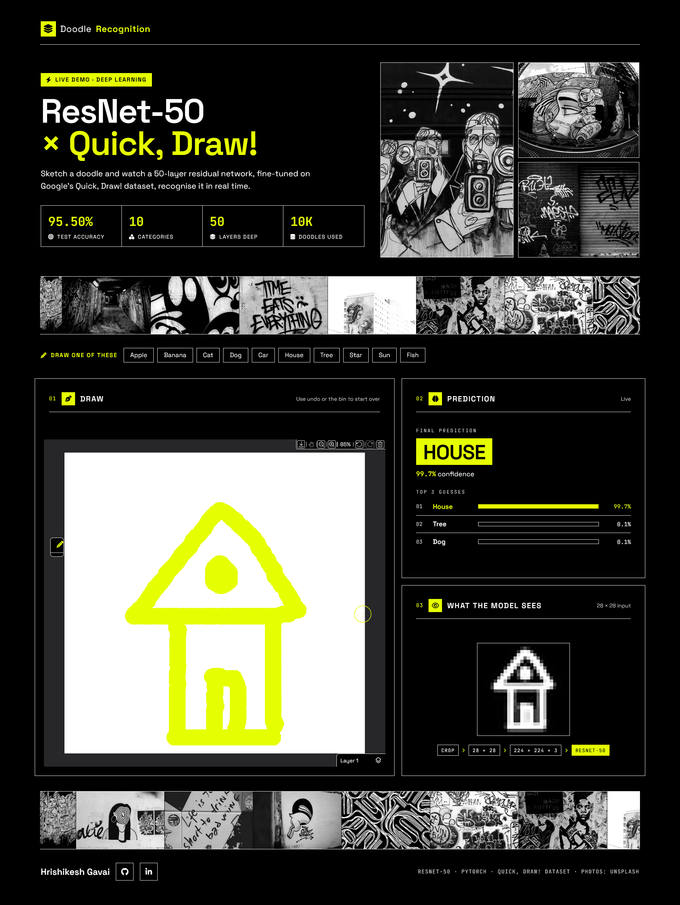

</div>

---

## 📌 What is this?

This is a beginner-friendly project in **three parts**:

| # | Part | What it shows | Folder |
|:-:|---|---|---|
| 1️⃣ | **CNN from scratch** | How a CNN works, one step at a time, in plain NumPy | `CNN/` |
| 2️⃣ | **ResNet-50 on Quick, Draw!** | Fine-tuning a real deep network and comparing it with an IEEE paper | `PPT/` |
| 3️⃣ | **Live doodle demo** | You draw, and the model guesses instantly (Gradio, in Colab) | `PPT/With-UI.ipynb` |

> 📄 **Reference paper:** *Analyzing Deep Learning in Quick, Draw!: A Case Study on Hand-drawn Sketch Recognition*, IEEE ICITCOM 2025 ([doi:10.1109/ICITCOM66635.2025.11265600](https://doi.org/10.1109/ICITCOM66635.2025.11265600))

---

## 🧱 Part 1: A CNN by hand

Before ResNet, we built every CNN step ourselves on **one 28×28 van doodle**, with no deep-learning library:

```text
28×28 van ─► pad 1 ─► 3×3 edge filter ─► ReLU ─► 2×2 max-pool ─► flatten ─► dense ─► softmax
             30×30      28×28 map        28×28      14×14          196        3        %
```

| Step | Simple meaning |
|---|---|
| 🔍 **Convolution** | Slide a small filter over the image to find vertical edges |
| ⚡ **ReLU** | Keep the positive signals and drop the negatives |
| 🗜️ **Max-pool** | Shrink the map and keep the strongest signal in each 2×2 patch |
| 🎯 **Softmax** | Turn scores into probabilities: **van 47.4%** · car 36.3% · bus 16.3% |

> 💡 The dense weights are random, so this part shows the *mechanics* of a CNN. It isn't a trained model.

> [!TIP]
> 📖 **Start here:** [**Hrishikesh_Gavai_CNN_Documentation.pdf**](CNN/Hrishikesh_Gavai_CNN_Documentation.pdf)
>
> It works through the **actual matrix computations, layer by layer, on a real image**. You see the pixel matrix, the filter sliding over it, the numbers after ReLU and pooling, the flattened vector, and the final softmax probabilities. If you want to understand what a CNN really *does* to an image, read this first, then run [`Quick, Draw! CNN.ipynb`](CNN/Quick,%20Draw!%20CNN.ipynb) alongside it.

---

## 🏗️ Part 2: ResNet-50

**The problem:** a very deep network learns *worse*, because the learning signal (the gradient) fades as it travels back through many layers.
**The fix:** a **skip connection** adds the input back to the output, which gives the signal a shortcut.

```
H(x) = F(x) + x
```

Each block is a **bottleneck**: `1×1 shrink → 3×3 look → 1×1 expand`. It is wide, then narrow, then wide, just like the neck of a bottle 🍾.

| Stage | Blocks | Output shape | What it "sees" |
|---|:-:|---|---|
| Stem (conv1 + maxpool) | – | 64 × 56 × 56 | Raw edges |
| Layer 1 | 3 | 256 × 56 × 56 | Lines and corners |
| Layer 2 | 4 | 512 × 28 × 28 | Simple shapes |
| Layer 3 | 6 | 1024 × 14 × 14 | Object parts |
| Layer 4 | 3 | 2048 × 7 × 7 | Whole-object patterns |
| Avg-pool → FC | – | N scores | The final guess ✅ |

> 🧮 **Why 50?** 1 (conv1) + 16 blocks × 3 convs + 1 (fc) = **50 layers**

### ⚙️ Setup (matches the paper)

| Setting | Value |
|---|---|
| 📦 Data | Quick, Draw! `numpy_bitmap`, **1,000 images per class** |
| ✂️ Split | 80 / 10 / 10 (stratified, seed 42) |
| 🖼️ Preprocess | 28→224 px, 1→3 channels, ImageNet normalisation |
| 🔁 Augment | Horizontal flip and ±10° rotation |
| 🧠 Model | `resnet50(weights="IMAGENET1K_V1")` with a new `fc` layer |
| 🏋️ Training | AdamW · lr `1e-5` · batch 64 · 15 epochs (20 for 50 classes) |

```python
model = torchvision.models.resnet50(weights="IMAGENET1K_V1")
model.fc = nn.Linear(2048, NUM_CLASSES)          # swap the head for our classes
optimizer = torch.optim.AdamW(model.parameters(), lr=1e-5)
```

---

## 🔬 Inside the network: one fish, layer by layer

We fed a single fish doodle through the model and looked at what each stage produces. Early layers keep the outline, and deeper layers turn into abstract "fish-ness" signals.

<div align="center">

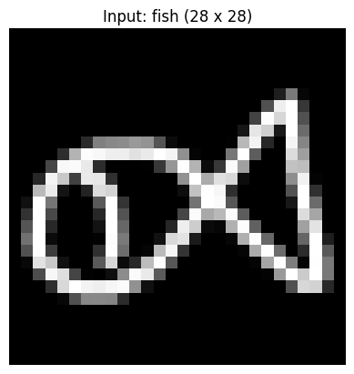
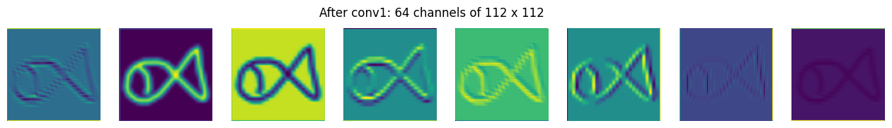
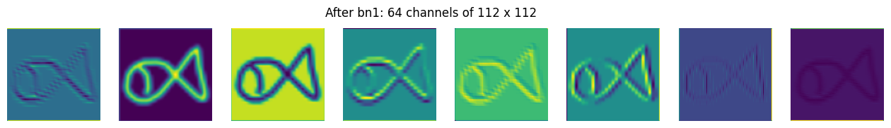
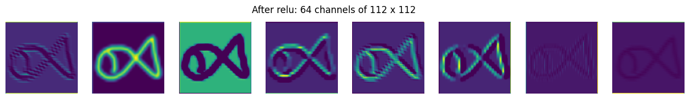
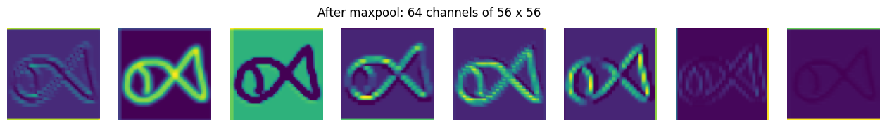
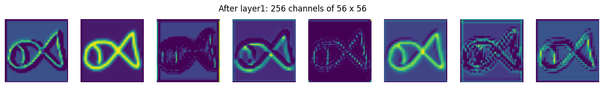
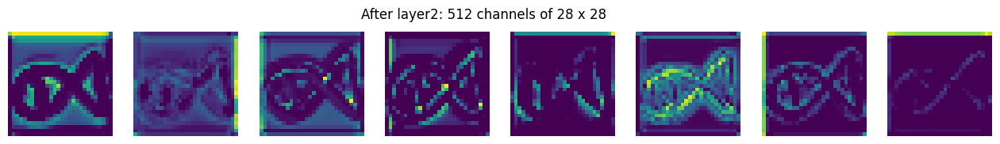
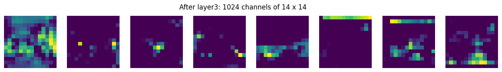
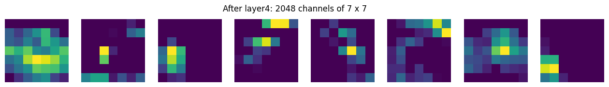
</div>

---

## 📊 Results vs the paper

| Classes | 🟡 Ours (test acc) | Our loss | 📄 Paper (val acc) | Paper loss | Δ |
|:-:|:-:|:-:|:-:|:-:|:-:|
| 10 | **95.70%** | 0.1542 | 94.60% | 0.1815 | 🟢 +1.10% |
| 20 | **93.90%** | 0.2123 | 93.70% | 0.2235 | 🟢 +0.20% |
| 30 | **92.40%** | 0.2826 | 91.10% | 0.3521 | 🟢 +1.30% |
| 50 | **92.04%** | 0.3633 | 88.18% | 0.4284 | 🟢 **+3.86%** |

✅ We **beat the paper in all 4 runs**, and the gap grows as the task gets harder.

<div align="center">
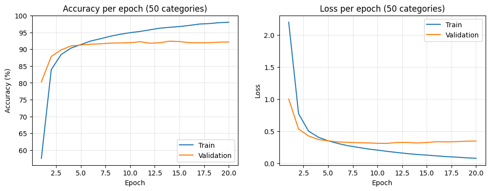
<br><sub>Accuracy and loss per epoch for the 50-class run</sub>
</div>

---

## 🎨 Part 3: Live demo

`PPT/With-UI.ipynb` retrains the 10-class model (**95.50%**) and launches a **Gradio** sketchpad. Draw something, and it shows the top guesses with confidence bars.

```bash
pip install "gradio<6" torch torchvision
# Open With-UI.ipynb in Colab → Runtime ▸ T4 GPU → Run all → open the public link
```

> ⚠️ The demo runs inside **Google Colab**, so the link stays live only while the notebook is running.

---

## 📁 Repository structure

```text
📦 main
├── 📁 CNN
│   ├── 📓 Quick, Draw! CNN.ipynb                 # NumPy CNN, step by step
│   └── 📄 Hrishikesh_Gavai_CNN_Documentation.pdf # full write-up
├── 📁 PPT
│   ├── 📓 Quick, Draw! Implementation.ipynb      # ResNet-50 · 10/20/30/50 classes
│   ├── 📓 With-UI.ipynb                          # 10-class model + Gradio demo
│   ├── 📊 PPT.pdf                                # 9-slide presentation
│   └── 📄 Analyzing_Deep_Learning_in_Quick_Draw_…pdf  # reference paper
├── 📁 assets                                     # README images
└── 📝 README.md
```

---

## 📚 References

| | Source |
|---|---|
| 📘 | He, Zhang, Ren & Sun, *Deep Residual Learning for Image Recognition*, CVPR 2016 |
| 📄 | *Analyzing Deep Learning in Quick, Draw!*, IEEE ICITCOM 2025 |
| 🗂️ | [Google Quick, Draw! Dataset](https://github.com/googlecreativelab/quickdraw-dataset) |

---

<div align="center">

**Made by Hrishikesh Gavai**

[](https://github.com/Hrishikesh-Gavai)
[](https://in.linkedin.com/in/hrishikesh-gavai)

</div>
